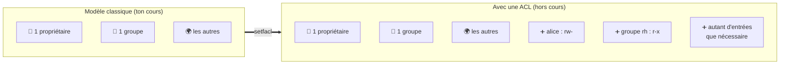
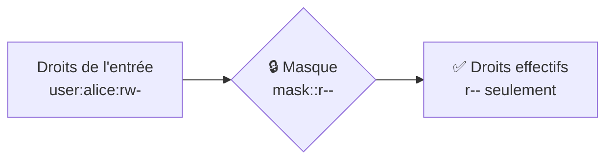
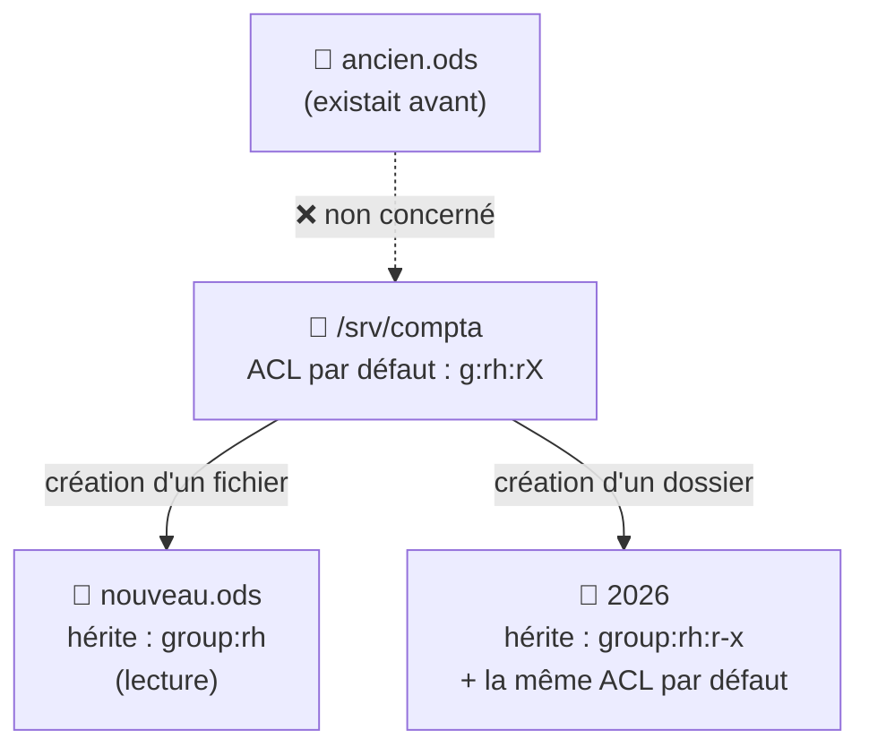
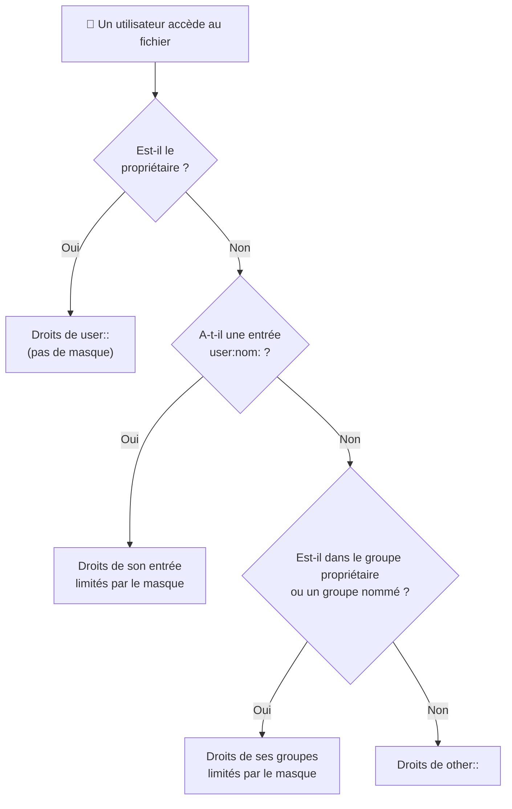

# Fiche — Les ACL sous Linux

> **Module M02 Administration Linux** (Oracle Linux / RHEL) · Comprendre, lire et poser des ACL POSIX avec `getfacl` et `setfacl`.

> ⚠️ **À savoir avant de commencer** : ton mémo de cours *« chmod, les droits sous Linux »* **ne traite pas les ACL**. La partie 1 reprend ce que dit ton cours ; **tout le reste de la fiche est hors cours**. Si ton support ENI du module M02 a un chapitre sur les ACL, colle-le moi et j'alignerai la fiche dessus.

---

## Sommaire

1. [Ce que dit ton cours : le modèle classique](#1-ce-que-dit-ton-cours--le-modèle-classique)
2. [Pourquoi les ACL ?](#2-pourquoi-les-acl-)
3. [Vérifier que les ACL sont disponibles](#3-vérifier-que-les-acl-sont-disponibles)
4. [Lire une ACL avec getfacl](#4-lire-une-acl-avec-getfacl)
5. [Poser et retirer des ACL avec setfacl](#5-poser-et-retirer-des-acl-avec-setfacl)
6. [Le masque : la notion la plus importante](#6-le-masque--la-notion-la-plus-importante)
7. [Les ACL par défaut : l'héritage](#7-les-acl-par-défaut--lhéritage)
8. [Dans quel ordre Linux vérifie les droits](#8-dans-quel-ordre-linux-vérifie-les-droits)
9. [Copier, déplacer et sauvegarder des ACL](#9-copier-déplacer-et-sauvegarder-des-acl)
10. [Cas pratique complet](#10-cas-pratique-complet)
11. [Comparaison avec les ACL NTFS de Windows](#11-comparaison-avec-les-acl-ntfs-de-windows)
12. [Les pièges à éviter](#12-les-pièges-à-éviter)
13. [Mémo des commandes](#13-mémo-des-commandes)
14. [Exercices corrigés](#14-exercices-corrigés)
15. [Testez-vous](#15-testez-vous)

---

## 1. Ce que dit ton cours : le modèle classique

> 📘 **Méthode du cours** : sections *« Les 10 caractères de ls -l »*, *« Notation octale »*, *« Notation symbolique »*, *« chown »* et *« Les droits spéciaux »* de ton mémo.

Le modèle de droits classique de Linux repose sur **3 catégories** :

| Catégorie | Lettre | Qui ? |
|---|---|---|
| **user** | `u` | Le **propriétaire** du fichier (un seul) |
| **group** | `g` | Le **groupe propriétaire** du fichier (un seul) |
| **others** | `o` | **Tous les autres** |

Chacune reçoit les droits `r` (4), `w` (2), `x` (1) :

```text
-rw-r-----  1  root  compta  1200  oct. 28 10:00  budget.ods
 └┬┘└┬┘└┬┘      └┬─┘  └─┬──┘
  u  g  o     proprio  groupe
```

```bash
chmod 640 budget.ods            # notation octale : u=rw, g=r, o=rien
chmod g+w budget.ods            # notation symbolique : ajoute w au groupe
chown root:compta budget.ods    # change le propriétaire et le groupe
```

Ton cours rappelle aussi qu'**un fichier n'a qu'un seul groupe propriétaire**. C'est justement cette limite que les ACL viennent lever.

---

> 🔵 **Hors cours** : à partir d'ici, tout le contenu est un **complément** qui n'est pas dans ton mémo.

---

## 2. Pourquoi les ACL ?

### Le problème

Le service Comptabilité a un dossier `/srv/compta`, qui appartient au groupe `compta` :

```text
drwxrwx---  root  compta  /srv/compta
```

On te demande ensuite :
- que le groupe **`rh`** puisse **lire** ce dossier, sans le modifier ;
- que l'utilisatrice **`alice`**, qui n'est pas comptable, puisse **modifier** les fichiers.

**Avec le modèle classique, c'est impossible.** Il n'y a qu'**un seul** groupe propriétaire (`compta`). Si tu ouvres les droits aux `others`, tu les ouvres à **tout le monde**.

### La solution

Une **ACL** (*Access Control List*, liste de contrôle d'accès) permet d'ajouter des droits pour **autant d'utilisateurs et de groupes que tu veux**, en plus du propriétaire, du groupe et des autres.



> 💡 Les ACL **complètent** les droits classiques, elles ne les remplacent pas. `chmod`, `chown` et tout ce que tu as vu en cours restent valables.

---

## 3. Vérifier que les ACL sont disponibles

Sur **Oracle Linux / RHEL**, tout est prêt par défaut :
- le système de fichiers par défaut, **XFS**, gère les ACL nativement ;
- le paquet **`acl`**, qui fournit `getfacl` et `setfacl`, est installé de base.

```bash
# Vérifie que le paquet acl est installé
rpm -q acl

# S'il manque (rare), installe-le
dnf install acl
```

---

## 4. Lire une ACL avec getfacl

### Le signe `+` dans ls -l

Quand un fichier ou un dossier a une ACL, `ls -l` affiche un **`+`** juste après les droits :

```text
drwxrwx---+  2  root  compta  6  oct. 28 10:00  compta
          ↑
          une ACL est présente : ls -l ne montre pas tout !
```

> ⚠️ Le `+` signifie que `ls -l` **ne suffit plus** pour connaître les droits réels. Il faut utiliser `getfacl`.

### Lire le résultat de getfacl

```bash
getfacl /srv/compta
```

```text
# file: srv/compta
# owner: root
# group: compta
user::rwx
user:alice:rw-
group::rwx
group:rh:r-x
mask::rwx
other::---
```

> 💡 Le message `getfacl: Removing leading '/' from absolute path names` est normal : il indique juste que le `/` du début est retiré de l'affichage.

### Les types d'entrées

| Entrée | Signification | Équivalent dans ton cours |
|---|---|---|
| `user::rwx` | Le **propriétaire** (rien entre les `::`) | `u` |
| `user:alice:rw-` | Un **utilisateur nommé** : alice | — *(nouveau)* |
| `group::rwx` | Le **groupe propriétaire** | `g` |
| `group:rh:r-x` | Un **groupe nommé** : rh | — *(nouveau)* |
| `mask::rwx` | Le **masque** : droits **maximum** des entrées nommées et du groupe | — *(nouveau, voir section 6)* |
| `other::---` | Les **autres** | `o` |

> 🧠 **Astuce de lecture** : `user::` avec **rien** entre les deux-points = le propriétaire. `user:alice:` avec **un nom** = un utilisateur ajouté par ACL. Même logique pour `group`.

---

## 5. Poser et retirer des ACL avec setfacl

### La syntaxe

```text
setfacl  OPTION  TYPE:NOM:DROITS  FICHIER
```

| Type | Abréviation | Exemple |
|---|---|---|
| `user` | `u` | `u:alice:rw` |
| `group` | `g` | `g:rh:rx` |
| `mask` | `m` | `m::rx` |
| `other` | `o` | `o::-` |

### Les options principales

| Option | Effet |
|---|---|
| `-m` | **Ajouter ou modifier** une entrée (*modify*) |
| `-x` | **Retirer** une entrée (*remove*) |
| `-b` | **Retirer toutes** les ACL, pour revenir aux droits classiques |
| `-R` | **Récursif** : le dossier et tout son contenu |
| `-d` | Agir sur l'ACL **par défaut** d'un dossier (voir section 7) |
| `-k` | Retirer l'ACL par défaut |

### Exemples commentés

```bash
# Donner lecture + écriture à l'utilisatrice alice sur un fichier
setfacl -m u:alice:rw budget.ods

# Donner lecture + traversée au groupe rh sur un dossier
# (rappel du cours : sur un dossier, r sans x ne sert presque à rien)
setfacl -m g:rh:rx /srv/compta

# Plusieurs entrées en une seule commande, séparées par des virgules
setfacl -m u:alice:rw,g:rh:r budget.ods

# Retirer l'entrée d'alice
setfacl -x u:alice budget.ods

# Retirer toutes les ACL du fichier
setfacl -b budget.ods

# Vérifier le résultat
getfacl budget.ods
```

> ⚠️ **Avec `-x`, on ne met pas de droits** : `setfacl -x u:alice` et non `setfacl -x u:alice:rw`.

### Appliquer à tout un dossier

```bash
# Donne au groupe rh la lecture sur le dossier ET tout son contenu
# X majuscule : x seulement sur les dossiers (et les fichiers déjà exécutables)
setfacl -R -m g:rh:rX /srv/compta
```

> 💡 **Le `X` majuscule** évite de rendre exécutables tous les fichiers texte. Il donne `x` aux **dossiers** (pour pouvoir les traverser) et aux fichiers qui étaient **déjà** exécutables.

> ⚠️ Comme pour `chmod -R` dans ton cours, sois **prudent avec `-R`** : teste d'abord sur un dossier de test.

---

## 6. Le masque : la notion la plus importante

### Le principe

Le **masque** (`mask`) fixe les droits **maximum** que peuvent avoir :
- les **utilisateurs nommés** (`user:alice:`) ;
- le **groupe propriétaire** (`group::`) ;
- les **groupes nommés** (`group:rh:`).

Il ne s'applique **pas** au propriétaire ni aux autres.



**Droit effectif = droits de l'entrée ET masque.** Un droit n'est accordé que s'il est **à la fois** dans l'entrée **et** dans le masque.

### Exemple

```text
user:alice:rw-          #effective:r--
group::rwx              #effective:r-x
group:rh:r-x
mask::r-x
```

alice a `rw-` dans son entrée, mais le masque ne contient pas `w`. **Elle ne peut que lire.** `getfacl` l'indique avec `#effective` (droits effectifs).

### Le piège : chmod modifie le masque

> 🚨 **Piège n°1 des ACL.** Quand un fichier a une ACL, la partie **group** de `ls -l` (les caractères 5 à 7) **n'affiche plus le groupe propriétaire, mais le masque**. Et `chmod g...` **modifie le masque**.

```bash
setfacl -m u:alice:rw budget.ods   # alice peut écrire
chmod g-w budget.ods               # on croit retirer l'écriture au groupe…
getfacl budget.ods                 # … mais alice a perdu l'écriture aussi !
```

```text
user:alice:rw-          #effective:r--
mask::r--
```

Un `chmod 640` ou `chmod 750` sur un fichier avec ACL peut donc **brider sans prévenir** les droits que tu as donnés par ACL.

**Comment s'en sortir :**

```bash
# Remettre le masque à la valeur voulue
setfacl -m m::rwx budget.ods
```

> 💡 **Bonne nouvelle** : `setfacl -m` **recalcule automatiquement** le masque pour qu'il couvre toutes les entrées. Tant que tu passes par `setfacl` et non par `chmod g...`, le masque reste cohérent.

---

## 7. Les ACL par défaut : l'héritage

### Le problème

Une ACL posée sur un dossier **ne s'applique pas** aux fichiers créés **ensuite** dedans. Si alice crée un nouveau fichier dans `/srv/compta`, le groupe `rh` ne pourra pas le lire.

### La solution : l'ACL par défaut

Une **ACL par défaut** (option `-d`) se pose **sur un dossier**. Elle est **copiée automatiquement** sur tout ce qui sera **créé** dedans.

```bash
# Tout nouveau fichier ou dossier créé dans /srv/compta
# donnera la lecture au groupe rh
setfacl -d -m g:rh:rX /srv/compta
```

```text
# getfacl /srv/compta
...
default:user::rwx
default:group::rwx
default:group:rh:r-x
default:mask::rwx
default:other::---
```



> ⚠️ **L'ACL par défaut ne touche que les éléments créés APRÈS.** Pour traiter aussi ce qui **existe déjà**, il faut les deux commandes :
>
> ```bash
> setfacl -R -m g:rh:rX /srv/compta      # 1. le contenu existant
> setfacl -d -m g:rh:rX /srv/compta      # 2. le contenu futur
> ```

> 📘 **Lien avec ton cours** (section *« Les droits spéciaux »*) : le **SetGID** sur un dossier fait hériter le **groupe propriétaire**. L'ACL par défaut fait hériter des **droits supplémentaires**. Les deux se combinent très bien sur un dossier partagé.

---

## 8. Dans quel ordre Linux vérifie les droits

Linux ne **cumule pas** toutes les entrées. Il teste les catégories **dans l'ordre** et **s'arrête à la première qui correspond**.



**Conséquence importante :** une entrée nommée à `---` **bloque** un utilisateur, même s'il est dans un groupe autorisé :

```bash
# bob est dans le groupe compta (rwx), mais on lui retire tout accès
setfacl -m u:bob:--- /srv/compta
```

bob a une entrée `user:bob:`, donc Linux s'arrête là : **aucun accès**, et les droits du groupe `compta` ne sont même pas regardés.

> 💡 C'est la façon de faire un **« refus »** avec les ACL Linux, qui n'ont pas de vrai mot-clé *refuser* comme Windows.

---

## 9. Copier, déplacer et sauvegarder des ACL

| Action | Les ACL sont-elles conservées ? |
|---|---|
| `mv` dans le même système de fichiers | ✅ Oui |
| `cp fichier destination` | ❌ Non : le fichier copié prend les droits par défaut |
| `cp -a` ou `cp --preserve=all` | ✅ Oui |
| `tar` | ⚠️ Seulement avec l'option `--acls` |

**Sauvegarder et restaurer les ACL d'une arborescence :**

```bash
# Sauvegarde toutes les ACL de /srv/compta dans un fichier texte
getfacl -R /srv/compta > /root/acl_compta.txt

# Les restaure plus tard (après une erreur, par exemple)
# ⚠️ se placer d'abord à la racine : la sauvegarde contient des chemins
#    sans le "/" du début (srv/compta), lus depuis le dossier courant
cd /
setfacl --restore=/root/acl_compta.txt
```

> 💡 Fais toujours cette sauvegarde **avant** une modification récursive (`setfacl -R`, `chmod -R`).

---

## 10. Cas pratique complet

**Objectif** : sur ta VM serveur, en **root**, créer un dossier partagé `/srv/compta` où :

| Qui | Droits voulus |
|---|---|
| Groupe **`compta`** (propriétaire) | Lecture + écriture |
| Groupe **`rh`** | Lecture seule |
| Utilisatrice **`alice`** (hors compta) | Lecture + écriture |
| Utilisateur **`bob`** (membre de compta) | **Aucun accès** |
| Tous les autres | Aucun accès |

### Étape 1 — Préparer les groupes et les utilisateurs

```bash
# Crée les groupes
groupadd compta
groupadd rh

# Crée les utilisateurs
useradd -G compta claire     # claire : comptable
useradd -G compta bob        # bob : comptable, mais à bloquer
useradd -G rh     romain     # romain : ressources humaines
useradd alice                # alice : dans aucun de ces groupes

# Vérifie les groupes de chacun
id claire; id bob; id romain; id alice
```

### Étape 2 — Créer le dossier avec les droits classiques (méthode du cours)

```bash
mkdir /srv/compta

# Propriétaire root, groupe compta
chown root:compta /srv/compta

# 2770 : SetGID (2) + rwx pour root, rwx pour compta, rien pour les autres
# Le SetGID fait hériter le groupe compta aux fichiers créés dedans
chmod 2770 /srv/compta
```

### Étape 3 — Ajouter les ACL (hors cours)

```bash
# Accès pour le contenu existant
setfacl -m g:rh:rx,u:alice:rwx,u:bob:--- /srv/compta

# Héritage pour le contenu futur
setfacl -d -m g:compta:rwx,g:rh:rX,u:alice:rwX,u:bob:--- /srv/compta

# Vérification
getfacl /srv/compta
```

### Étape 4 — Tester avec chaque utilisateur

En root, `su nom -c "commande"` lance une commande sous l'identité d'un autre utilisateur, sans mot de passe :

```bash
su claire -c "touch /srv/compta/test.txt"     # ✅ doit réussir
su romain -c "ls /srv/compta"                 # ✅ doit réussir (lecture)
su romain -c "touch /srv/compta/rh.txt"       # ❌ Permission non accordée
su alice  -c "touch /srv/compta/alice.txt"    # ✅ doit réussir
su bob    -c "ls /srv/compta"                 # ❌ Permission non accordée
```

Vérifie l'héritage sur le fichier créé par claire :

```bash
getfacl /srv/compta/test.txt
```

Résultat obtenu (testé) :

```text
# file: srv/compta/test.txt
# owner: claire
# group: compta
user::rw-
user:bob:---
user:alice:rwx          #effective:rw-
group::rwx              #effective:rw-
group:compta:rwx        #effective:rw-
group:rh:r-x            #effective:r--
mask::rw-
other::---
```

> 💡 **Ce qu'il faut remarquer :**
>
> - le groupe est bien `compta` grâce au **SetGID** du dossier ;
> - les entrées sont héritées de l'ACL par défaut ;
> - le **masque** vaut `rw-` : un fichier créé par `touch` n'est jamais exécutable, donc le masque retire le `x`. romain (groupe `rh`) a donc un droit **effectif** de lecture seule, c'est exactement ce qu'on voulait.
>
> Sur le dossier, `getfacl` affiche aussi une ligne `# flags: -s-` : c'est le **SetGID**.

### Étape 5 — Nettoyer (si besoin)

```bash
rm -rf /srv/compta
userdel -r claire; userdel -r bob; userdel -r romain; userdel -r alice
groupdel compta; groupdel rh
```

---

## 11. Comparaison avec les ACL NTFS de Windows

Tu as déjà manipulé des ACL au **TP4 Windows** (onglet Sécurité, `icacls`). Le principe est le même : une liste qui dit **qui** a **quels droits**.

| | **Linux (ACL POSIX)** | **Windows (ACL NTFS)** |
|---|---|---|
| Commandes | `getfacl` / `setfacl` | `icacls`, onglet **Sécurité** |
| Droits | `r`, `w`, `x` | Lecture, Écriture, Modification, Contrôle total + droits avancés |
| Refus explicite | ❌ Pas de mot-clé : on met une entrée nommée à `---` | ✅ **Refuser**, prioritaire |
| Héritage | Seulement avec une **ACL par défaut** (`-d`) | **Automatique** par défaut (désactivable) |
| Masque | ✅ Oui, limite les entrées nommées et le groupe | ❌ Pas de masque |
| Cumul | ❌ Ordre de vérification, la 1re catégorie qui correspond gagne | ✅ Les droits des groupes **s'additionnent** |

> 🧠 **Le piège quand on passe de Windows à Linux** : sous Windows, si tu es dans 2 groupes, tes droits **s'additionnent**. Sous Linux, une entrée `user:toi:` **remplace** tes droits de groupe. Elle ne s'y ajoute pas.

---

## 12. Les pièges à éviter

| Piège | Ce qui se passe | Solution |
|---|---|---|
| Lire les droits avec `ls -l` | Le `+` signale que `ls -l` ne montre pas tout | Toujours `getfacl` |
| `chmod g...` sur un fichier avec ACL | Modifie le **masque** et peut brider toutes les ACL | Utiliser `setfacl`, ou remettre le masque avec `setfacl -m m::rwx` |
| ACL sur le dossier seulement | Les nouveaux fichiers n'en profitent pas | Ajouter une **ACL par défaut** (`-d`) |
| ACL par défaut seulement | Les fichiers **existants** ne sont pas concernés | Combiner `-R -m` et `-d -m` |
| `r` sans `x` sur un dossier | On ne peut pas entrer dans le dossier (déjà dans ton cours) | Toujours `rx` (ou `rX`) sur un dossier |
| `-x` avec des droits | `setfacl -x u:alice:rw` est une erreur de syntaxe | `setfacl -x u:alice` |
| `cp` sans option | La copie perd les ACL | `cp -a` |

---

## 13. Mémo des commandes

| Commande | Effet |
|---|---|
| `getfacl fichier` | Afficher l'ACL |
| `getfacl -R dossier > sauvegarde.txt` | Sauvegarder les ACL d'une arborescence |
| `setfacl --restore=sauvegarde.txt` | Restaurer les ACL |
| `setfacl -m u:alice:rw fichier` | Donner `rw` à l'utilisatrice alice |
| `setfacl -m g:rh:rx dossier` | Donner `rx` au groupe rh |
| `setfacl -m u:bob:--- dossier` | Bloquer bob |
| `setfacl -m m::rwx fichier` | Remettre le masque à `rwx` |
| `setfacl -R -m g:rh:rX dossier` | Appliquer à tout le contenu existant |
| `setfacl -d -m g:rh:rX dossier` | ACL par défaut (héritage pour le contenu futur) |
| `setfacl -x u:alice fichier` | Retirer l'entrée d'alice |
| `setfacl -k dossier` | Retirer l'ACL par défaut |
| `setfacl -b fichier` | Retirer toutes les ACL |
| `cp -a source destination` | Copier en conservant les ACL |

---

## 14. Exercices corrigés

**Exercice 1 — Lire une ACL.** Que peut faire `paul` sur ce fichier ?

```text
# file: rapport.txt
# owner: root
# group: direction
user::rw-
user:paul:rw-          #effective:r--
group::r--
mask::r--
other::---
```

> ✅ **Corrigé** : paul a `rw-` dans son entrée, mais le masque vaut `r--`. Son droit effectif est **`r--`** : il peut seulement **lire**.

**Exercice 2 — Le piège du chmod.** Un fichier a l'ACL `user:alice:rw-` et le masque `rw-`. Tu fais `chmod 640 fichier`. Qu'arrive-t-il à alice ?

> ✅ **Corrigé** : `640` met la partie group à `r--`, donc le **masque** passe à `r--`. alice ne peut plus que **lire**. Pour lui rendre l'écriture : `setfacl -m m::rw fichier`.

**Exercice 3 — Écrire la commande.** Donne au groupe `direction` la lecture sur `/srv/compta`, sur ce qui existe déjà **et** sur ce qui sera créé.

> ✅ **Corrigé** :
>
> ```bash
> setfacl -R -m g:direction:rX /srv/compta
> setfacl -d -m g:direction:rX /srv/compta
> ```

**Exercice 4 — L'ordre de vérification.** `marc` est membre du groupe `compta`, qui a `rwx` sur un dossier. Tu ajoutes `setfacl -m u:marc:r-x dossier`. Peut-il encore créer des fichiers ?

> ✅ **Corrigé** : **Non**. marc a maintenant une entrée nommée `user:marc:`. Linux s'arrête dessus et ne regarde plus ses groupes. Il n'a que `r-x` : il peut lire et entrer, mais pas créer de fichiers.

**Exercice 5 — Le `+`.** Tu vois `-rw-rw----+` dans `ls -l`. Que signifie le `+`, et que représente le `rw-` du milieu ?

> ✅ **Corrigé** : le `+` indique qu'une **ACL** est présente. Le `rw-` du milieu n'est plus le droit du groupe propriétaire : c'est le **masque**. Pour voir les vrais droits : `getfacl`.

---

## 15. Testez-vous

Essaie de répondre de tête avant de lire la réponse.

**1. Quelle limite du modèle classique les ACL viennent-elles lever ?**

> ✅ **Réponse** : un fichier n'a qu'**un seul propriétaire** et **un seul groupe**. Les ACL permettent de donner des droits à **d'autres utilisateurs et groupes**, sans ouvrir aux `others`.

**2. Quelles sont les deux commandes des ACL et à quoi servent-elles ?**

> ✅ **Réponse** : `getfacl` pour **lire** une ACL, `setfacl` pour la **modifier**.

**3. Quelle est la différence entre `user::rwx` et `user:alice:rwx` ?**

> ✅ **Réponse** : `user::` (rien entre les deux-points) désigne le **propriétaire**. `user:alice:` désigne un **utilisateur nommé** ajouté par ACL.

**4. À quoi sert le masque ?**

> ✅ **Réponse** : il fixe les droits **maximum** des utilisateurs nommés, du groupe propriétaire et des groupes nommés. Droit effectif = entrée **ET** masque.

**5. Pourquoi faut-il éviter `chmod g...` sur un fichier qui a une ACL ?**

> ✅ **Réponse** : parce que la partie group de `chmod` modifie alors le **masque**, ce qui peut réduire les droits de **toutes** les entrées ACL.

**6. Une ACL posée sur un dossier s'applique-t-elle aux fichiers créés ensuite ?**

> ✅ **Réponse** : **Non**. Il faut une **ACL par défaut** : `setfacl -d -m …`.

**7. Comment bloquer un utilisateur membre d'un groupe autorisé ?**

> ✅ **Réponse** : en lui donnant une entrée nommée vide, `setfacl -m u:bob:--- dossier`. Linux s'arrête sur son entrée personnelle et ne regarde pas ses groupes.

**8. Quelle commande copie un fichier en conservant ses ACL ?**

> ✅ **Réponse** : `cp -a` (ou `cp --preserve=all`).

**9. Comment retirer toutes les ACL d'un fichier ?**

> ✅ **Réponse** : `setfacl -b fichier`.

**10. Sous Windows, les droits de deux groupes s'additionnent. Est-ce pareil avec les ACL Linux ?**

> ✅ **Réponse** : **Pas toujours**. Entre plusieurs **groupes**, Linux accorde l'accès si l'un d'eux le permet. Mais une entrée **utilisateur nommée** passe **avant** les groupes et remplace leurs droits.
