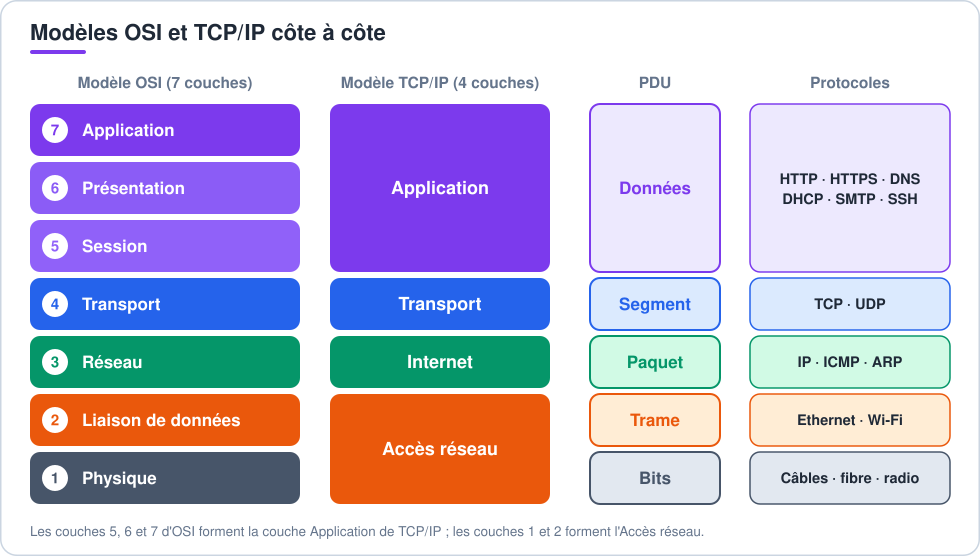
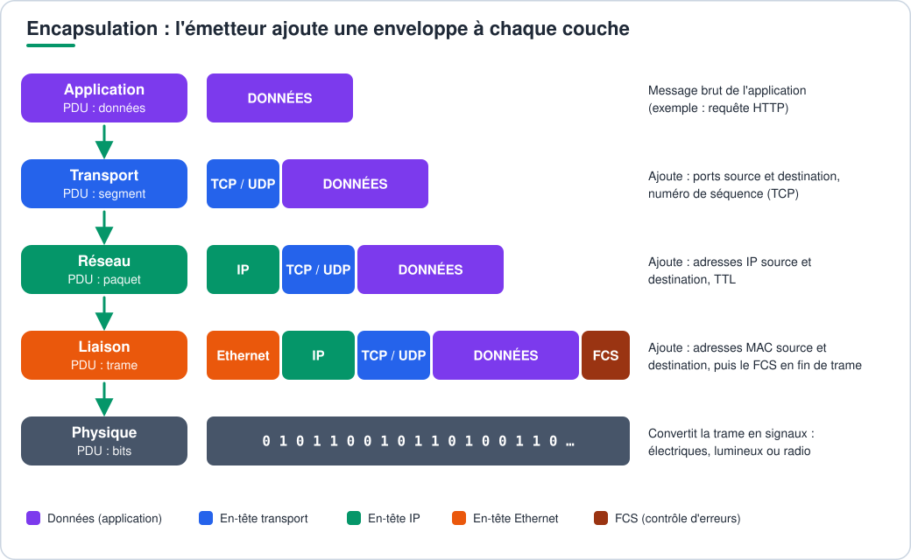
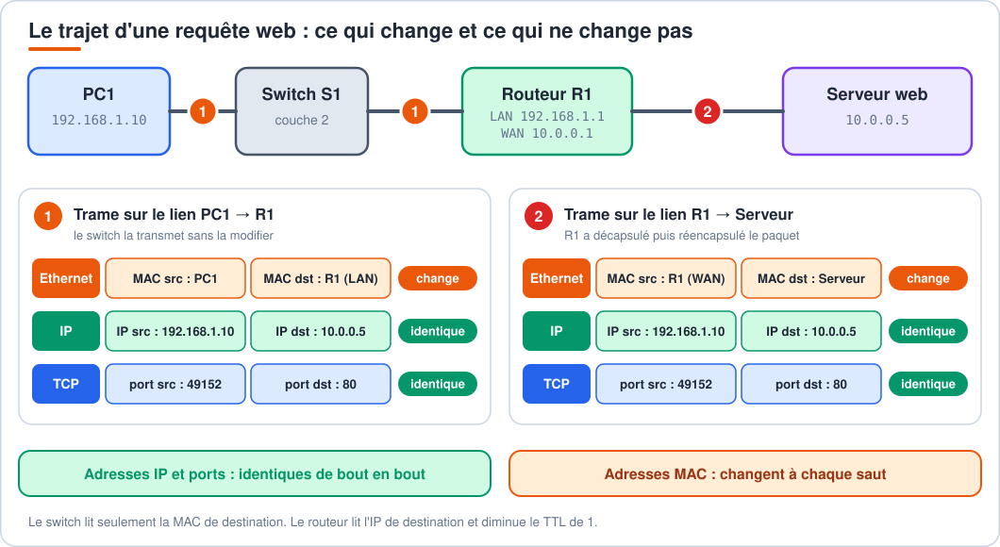
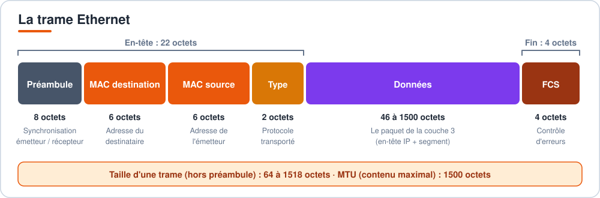
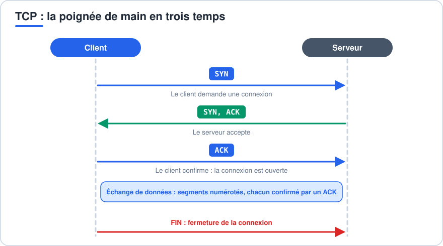
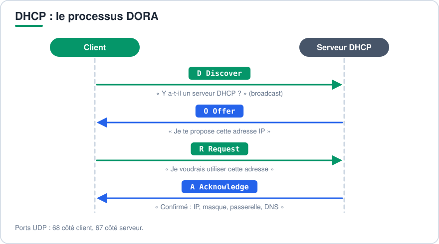
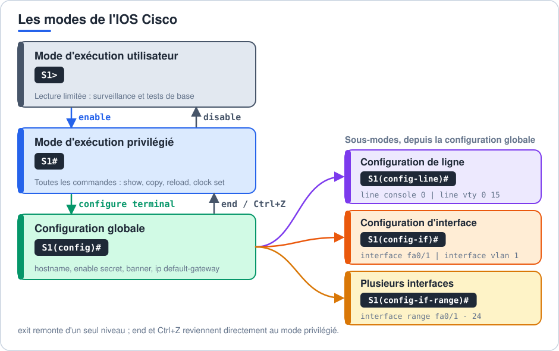

# CCNA 1 : la fiche pédagogique complète

Cette fiche explique tout le programme du CCNA 1 (Introduction aux réseaux, ITN) dans l'ordre où on le comprend le mieux : d'abord ce qu'est un réseau, ensuite comment les données voyagent (modèles, encapsulation), puis chaque couche, et enfin la configuration des équipements Cisco.

Elle suit le découpage des modules NetAcad ITN v7. Si ton cours est organisé autrement, les notions restent les mêmes.

**Comment l'utiliser**

- Les encadrés violets **À retenir** résument l'essentiel d'une partie : ce sont les phrases à connaître pour l'examen. Les encadrés jaunes signalent un piège, les verts une astuce, les bleus une précision hors programme.
- Les blocs de code sont des commandes Cisco IOS à taper telles quelles.
- Les parties 5, 6 et 7 sont les plus importantes pour comprendre le reste : l'encapsulation est la clé de tout le CCNA.

## Sommaire

1. [Les réseaux, équipements, médias et topologies](#1-les-réseaux-équipements-médias-et-topologies)
    - [Équipements terminaux et intermédiaires](#équipements-terminaux-et-intermédiaires)
    - [Médias](#médias)
    - [Topologies physique et logique](#topologies-physique-et-logique)
    - [Types de réseaux, LAN, WAN, Internet](#types-de-réseaux-lan-wan-internet)
    - [Accéder à Internet](#accéder-à-internet)
    - [Réseaux fiables, les 4 caractéristiques](#réseaux-fiables-les-4-caractéristiques)
    - [Tendances, BYOD, cloud](#tendances-byod-cloud)
2. [Les protocoles et les modèles de communication](#2-les-protocoles-et-les-modèles-de-communication)
    - [Protocole, définition et exemples](#protocole-définition-et-exemples)
    - [Le modèle OSI](#le-modèle-osi)
    - [Le modèle TCP/IP](#le-modèle-tcpip)
    - [OSI et TCP/IP côte à côte](#osi-et-tcpip-côte-à-côte)
3. [L'encapsulation et la décapsulation (la clé du CCNA)](#3-lencapsulation-et-la-décapsulation-la-clé-du-ccna)
    - [Le principe](#le-principe)
    - [Les PDU, données, segment, paquet, trame, bits](#les-pdu-données-segment-paquet-trame-bits)
    - [Encapsulation pas à pas](#encapsulation-pas-à-pas)
    - [Décapsulation, le chemin inverse](#décapsulation-le-chemin-inverse)
    - [Exemple complet, un PC demande une page web](#exemple-complet-un-pc-demande-une-page-web)
    - [Qui lit quoi, hub, switch, routeur](#qui-lit-quoi-hub-switch-routeur)
    - [Les trois types d'adresses](#les-trois-types-dadresses)
4. [Systèmes de numération](#4-systèmes-de-numération)
5. [La couche physique](#5-la-couche-physique)
    - [Débit, bande passante, latence](#débit-bande-passante-latence)
    - [Cuivre, fibre, sans fil](#cuivre-fibre-sans-fil)
    - [Câbles droit, croisé, console](#câbles-droit-croisé-console)
6. [La couche liaison de données et Ethernet](#6-la-couche-liaison-de-données-et-ethernet)
    - [La trame Ethernet](#la-trame-ethernet)
    - [L'adresse MAC](#ladresse-mac)
    - [Duplex et collisions](#duplex-et-collisions)
    - [Comment un switch fonctionne](#comment-un-switch-fonctionne)
7. [La couche réseau, le routage et la résolution d'adresses](#7-la-couche-réseau-le-routage-et-la-résolution-dadresses)
    - [Le paquet IPv4](#le-paquet-ipv4)
    - [Hôte, passerelle, routeur](#hôte-passerelle-routeur)
    - [La table de routage](#la-table-de-routage)
    - [ARP, retrouver une adresse MAC](#arp-retrouver-une-adresse-mac)
    - [ICMP, tests et messages d'erreur](#icmp-tests-et-messages-derreur)
8. [L'adressage IPv4 et les sous-réseaux](#8-ladressage-ipv4-et-les-sous-réseaux)
    - [Structure d'une adresse IPv4](#structure-dune-adresse-ipv4)
    - [Adresses spéciales](#adresses-spéciales)
    - [Masques et notation CIDR](#masques-et-notation-cidr)
    - [Méthode de découpage en sous-réseaux](#méthode-de-découpage-en-sous-réseaux)
    - [VLSM](#vlsm)
9. [L'adressage IPv6](#9-ladressage-ipv6)
10. [La couche transport, TCP et UDP](#10-la-couche-transport-tcp-et-udp)
11. [La couche application et les services](#11-la-couche-application-et-les-services)
12. [La sécurité réseau](#12-la-sécurité-réseau)
13. [Configuration Cisco IOS, modes, sécurité, interfaces](#13-configuration-cisco-ios-modes-sécurité-interfaces)
    - [Les modes IOS](#les-modes-ios)
    - [Navigation et aide](#navigation-et-aide)
    - [Sécuriser l'accès](#sécuriser-laccès)
    - [Configuration de base d'un switch](#configuration-de-base-dun-switch)
    - [Configuration de base d'un routeur](#configuration-de-base-dun-routeur)
    - [Sauvegarde, vérification, remise à zéro](#sauvegarde-vérification-remise-à-zéro)
    - [Interfaces et nommage](#interfaces-et-nommage)
    - [Séquence type d'une configuration de base](#séquence-type-dune-configuration-de-base)
14. [Tests et dépannage](#14-tests-et-dépannage)
15. [Tips d'examen et pièges fréquents](#15-tips-dexamen-et-pièges-fréquents)
16. [Mémo, où se configure quoi](#16-mémo-où-se-configure-quoi)

---

## 1. Les réseaux, équipements, médias et topologies

Un réseau est un ensemble d'équipements reliés entre eux pour échanger des données et partager des ressources (fichiers, imprimantes, connexion Internet).

### Équipements terminaux et intermédiaires

| Catégorie | Rôle | Exemples |
| --- | --- | --- |
| **Équipement terminal** (hôte, end device) | origine ou destination des données | PC, serveur, smartphone, imprimante, caméra IP |
| **Équipement intermédiaire** | relie les terminaux et fait circuler les données | switch, routeur, point d'accès Wi-Fi, pare-feu |

Les équipements intermédiaires :

- relient les terminaux entre eux (switch) ;
- relient des réseaux entre eux (routeur) ;
- peuvent filtrer le trafic (pare-feu) ;
- choisissent le meilleur chemin et retransmettent les données.

> [!IMPORTANT]
> **À retenir**
>
> Un hôte a une adresse IP et envoie ou reçoit des données. Un équipement intermédiaire fait transiter les données des autres.

### Médias

Le média est le support qui transporte les signaux.

| Média | Principe | Usage |
| --- | --- | --- |
| Câble en cuivre | signaux électriques | réseaux locaux, courtes distances (100 m max) |
| Fibre optique | impulsions lumineuses | longues distances, très haut débit |
| Sans fil | ondes radio | mobilité, Wi-Fi, cellulaire |

### Topologies physique et logique

| Topologie | Ce qu'elle montre |
| --- | --- |
| **Physique** | l'emplacement des équipements, les câbles, quels terminaux sont reliés à quels équipements intermédiaires et avec quel média |
| **Logique** | comment les données circulent : adresses IP, noms d'interfaces, sous-réseaux, sans se soucier du câblage |

### Types de réseaux, LAN, WAN, Internet

| Type | Définition |
| --- | --- |
| **LAN** (Local Area Network) | réseau local, zone géographique limitée (maison, bureau, école), géré par une seule organisation |
| **WAN** (Wide Area Network) | réseau étendu, relie des LAN éloignés, souvent via un fournisseur d'accès |
| **Intranet** | réseau privé d'une organisation, accessible à ses seuls membres |
| **Extranet** | accès contrôlé donné à des personnes extérieures (clients, partenaires) |
| **Internet** | ensemble mondial de réseaux interconnectés, sans propriétaire unique |

Autres sigles : **SOHO** (petit bureau ou bureau à domicile), **WLAN** (LAN sans fil).

### Accéder à Internet

| Avec connexion filaire jusqu'au bâtiment | Sans câble dédié |
| --- | --- |
| DSL (ligne téléphonique en cuivre), câble coaxial, fibre optique, ligne louée spécialisée, liaison commutée (dial-up) | cellulaire (3G/4G/5G), satellite, WISP (fournisseur d'accès sans fil) |

Un **WISP** est recommandé pour une ferme dans une zone rurale sans accès filaire à large bande.

### Réseaux fiables, les 4 caractéristiques

| Caractéristique | Idée |
| --- | --- |
| **Tolérance aux pannes** | le réseau continue de fonctionner si un équipement ou un lien tombe, grâce à la redondance |
| **Extensibilité** (scalability) | le réseau s'agrandit (utilisateurs, applications) sans dégrader le service pour les utilisateurs existants ; il s'appuie sur des équipements modulaires |
| **Qualité de service** (QoS) | le trafic sensible (voix, vidéo) est prioritaire sur le reste |
| **Sécurité** | confidentialité, intégrité, disponibilité des données |

### Tendances, BYOD, cloud

- **BYOD** (Bring Your Own Device) : les utilisateurs se connectent avec leurs propres appareils. L'entreprise doit définir où et comment ces appareils peuvent accéder aux ressources, et renforcer sa sécurité.
- **Collaboration en ligne** : visioconférence, messagerie, documents partagés.
- **Cloud computing** : stockage et services hébergés chez un fournisseur, accessibles par Internet (cloud public, privé, hybride, communautaire).
- **Courant porteur en ligne** : transmission de données par le réseau électrique.

[Retour au sommaire](#sommaire)

---

## 2. Les protocoles et les modèles de communication

### Protocole, définition et exemples

Un **protocole** est un ensemble de règles que deux équipements respectent pour communiquer : format des messages, ordre des échanges, vérification, gestion des erreurs.

Exemples : HTTP (pages web), TCP (transport fiable), IP (adressage et routage), Ethernet (liaison locale).

Une **suite de protocoles** est un groupe de protocoles qui fonctionnent ensemble. TCP/IP est la suite utilisée partout aujourd'hui.

### Le modèle OSI

Le modèle OSI découpe la communication en **7 couches**. Chaque couche a un rôle précis et ne parle qu'à celle du dessus et à celle du dessous.

| N° | Couche | Rôle | PDU | Exemples |
| --- | --- | --- | --- | --- |
| 7 | **Application** | interface entre l'utilisateur et le réseau | données | HTTP, DNS, SMTP |
| 6 | **Présentation** | format, chiffrement, compression | données | JPEG, TLS |
| 5 | **Session** | ouvre, gère, ferme les dialogues | données | |
| 4 | **Transport** | découpe en segments, fiabilité, ports | **segment** | TCP, UDP |
| 3 | **Réseau** | adresses logiques, choix du chemin | **paquet** | IP, ICMP |
| 2 | **Liaison de données** | adresses MAC, accès au média | **trame** | Ethernet, Wi-Fi |
| 1 | **Physique** | transmission des bits sur le média | **bits** | câbles, signaux |

Moyen mnémotechnique, de la couche 7 à la 1 (en anglais) : *All People Seem To Need Data Processing* (Application, Presentation, Session, Transport, Network, Data link, Physical).

### Le modèle TCP/IP

Le modèle TCP/IP n'a que **4 couches** et correspond à ce qui est réellement utilisé.

| Couche TCP/IP | Rôle | Protocoles |
| --- | --- | --- |
| **Application** | services aux applications | HTTP, HTTPS, FTP, DNS, DHCP, SMTP, SSH |
| **Transport** | communication de bout en bout | TCP, UDP |
| **Internet** | adressage et routage | IPv4, IPv6, ICMP, ARP |
| **Accès réseau** | accès au média local | Ethernet, Wi-Fi |

### OSI et TCP/IP côte à côte



> [!IMPORTANT]
> **À retenir**
>
> - OSI est la référence théorique (7 couches), TCP/IP est le modèle réel (4 couches).
> - Les couches 5, 6 et 7 d'OSI forment « Application » dans TCP/IP ; les couches 1 et 2 forment « Accès réseau ».

[Retour au sommaire](#sommaire)

---

## 3. L'encapsulation et la décapsulation (la clé du CCNA)

### Le principe

Quand une application envoie des données, elles descendent les couches une à une. À chaque couche, le système **ajoute une enveloppe** (un en-tête, parfois aussi une fin) qui contient les informations dont cette couche a besoin. C'est l'**encapsulation**.

À l'arrivée, c'est l'inverse : chaque couche lit son en-tête, le retire, et passe le contenu à la couche du dessus. C'est la **décapsulation**.

Image : une lettre (données) mise dans une enveloppe (segment), elle-même glissée dans un colis avec une adresse (paquet), lui-même chargé dans un camion avec une plaque (trame). À l'arrivée, on ouvre le camion, puis le colis, puis l'enveloppe.

### Les PDU, données, segment, paquet, trame, bits

Une **PDU** (Protocol Data Unit) est le nom que prennent les données à chaque couche.

| Couche | Nom de la PDU | Ce que la couche ajoute |
| --- | --- | --- |
| Application | **Données** | rien, c'est le message brut |
| Transport | **Segment** (TCP) ou **datagramme** (UDP) | en-tête TCP/UDP : ports source et destination, numéros de séquence |
| Réseau | **Paquet** | en-tête IP : adresses IP source et destination, TTL |
| Liaison de données | **Trame** | en-tête Ethernet : adresses MAC source et destination, type ; en fin : FCS |
| Physique | **Bits** | aucun en-tête : signal électrique, lumineux ou radio |

> [!IMPORTANT]
> **À retenir**
>
> De haut en bas : **Données, Segment, Paquet, Trame, Bits**. Segment = couche 4, paquet = couche 3, trame = couche 2.

### Encapsulation pas à pas



Ce que contient chaque en-tête :

| En-tête | Informations principales |
| --- | --- |
| **TCP / UDP** | port source, port destination, (TCP : numéro de séquence, accusé de réception, fenêtre, drapeaux SYN/ACK/FIN) |
| **IP** | adresse IP source, adresse IP destination, TTL, protocole transporté |
| **Ethernet** | adresse MAC destination, adresse MAC source, type (ex. IPv4), puis FCS de contrôle à la fin |

### Décapsulation, le chemin inverse

Chez le destinataire, tout se lit de bas en haut :

1. La **couche physique** reçoit les bits et les transmet à la couche liaison.
2. La **couche liaison** lit la trame. Elle vérifie que l'adresse MAC de destination est la sienne, contrôle le FCS, retire l'en-tête Ethernet et passe le **paquet** à la couche réseau.
3. La **couche réseau** lit l'en-tête IP, vérifie l'adresse IP de destination, retire l'en-tête et passe le **segment** à la couche transport.
4. La **couche transport** lit l'en-tête TCP/UDP, regarde le **port de destination** pour savoir quelle application doit recevoir les données, retire l'en-tête et passe les **données** à l'application.
5. L'**application** reçoit les données.


### Exemple complet, un PC demande une page web

PC1 (`192.168.1.10`) veut afficher la page d'un serveur web (`10.0.0.5`), situé dans un autre réseau. Un routeur R1 (`192.168.1.1` côté PC1) les sépare.



**Chez PC1 (encapsulation)**

1. Le navigateur crée une requête HTTP : ce sont les **données**.
2. TCP ajoute son en-tête : port source `49152` (tiré au hasard), port destination `80` (HTTP). On obtient un **segment**.
3. IP ajoute son en-tête : IP source `192.168.1.10`, IP destination `10.0.0.5`. On obtient un **paquet**.
4. Le serveur n'est pas dans le même réseau, donc PC1 envoie la trame à sa **passerelle**. Il utilise ARP pour connaître l'adresse MAC de la passerelle. Ethernet ajoute : MAC source = MAC de PC1, **MAC destination = MAC du routeur**. On obtient une **trame**.
5. La carte réseau envoie les **bits**.

**Dans le switch**

Le switch lit seulement la **couche 2** : il regarde la MAC de destination dans la trame, consulte sa table MAC, et fait sortir la trame par le bon port. Il ne regarde pas les adresses IP.

**Dans le routeur R1**

1. Il reçoit la trame, la décapsule jusqu'à la couche 3 et lit l'adresse IP de destination `10.0.0.5`.
2. Il consulte sa table de routage pour savoir par quelle interface envoyer le paquet, et **diminue le TTL de 1**.
3. Il réencapsule le paquet dans une **nouvelle trame** pour le prochain saut : nouvelle MAC source (celle de son interface de sortie), nouvelle MAC destination (celle du serveur ou du routeur suivant).

**Chez le serveur (décapsulation)**

La trame est décapsulée jusqu'aux données : couche 2 (MAC reconnue), couche 3 (IP reconnue), couche 4 (port 80, donc service web), couche 7 (le serveur HTTP traite la requête). La réponse repart dans l'autre sens, avec port source `80` et port destination `49152`.

> [!IMPORTANT]
> **À retenir, la règle d'or**
>
> - Les **adresses IP** (source et destination) et les **ports** restent les mêmes de bout en bout.
> - Les **adresses MAC** changent à chaque saut, car elles ne servent que dans le réseau local.

### Qui lit quoi, hub, switch, routeur

| Équipement | Couche | Il lit | Il décide avec |
| --- | --- | --- | --- |
| Hub (concentrateur) | 1 | rien, il répète les bits sur tous les ports | rien |
| **Switch** | 2 | l'en-tête Ethernet | l'**adresse MAC** de destination |
| **Routeur** | 3 | l'en-tête IP | l'**adresse IP** de destination et sa table de routage |
| Pare-feu | 3 à 7 | selon le type | règles de filtrage |

### Les trois types d'adresses

| Adresse | Couche | Taille | Rôle | Portée |
| --- | --- | --- | --- | --- |
| **MAC** | 2 | 48 bits (12 hexa) | identifie la carte réseau dans le réseau local | locale, change à chaque saut |
| **IP** | 3 | 32 bits (IPv4) ou 128 bits (IPv6) | identifie l'hôte dans un réseau, permet le routage | de bout en bout |
| **Port** | 4 | 16 bits (0 à 65535) | identifie l'application ou le service sur l'hôte | de bout en bout |

[Retour au sommaire](#sommaire)

---

## 4. Systèmes de numération

Les ordinateurs travaillent en binaire. Les adresses IP et MAC se lisent en décimal et en hexadécimal.

**Binaire vers décimal** : on additionne les valeurs des bits à 1.

| Position | 128 | 64 | 32 | 16 | 8 | 4 | 2 | 1 |
| --- | --- | --- | --- | --- | --- | --- | --- | --- |
| 192 | 1 | 1 | 0 | 0 | 0 | 0 | 0 | 0 |
| 168 | 1 | 0 | 1 | 0 | 1 | 0 | 0 | 0 |
| 255 | 1 | 1 | 1 | 1 | 1 | 1 | 1 | 1 |

192 = 128 + 64 ; 168 = 128 + 32 + 8.

**Décimal vers binaire** : on part de 128 et on soustrait. Si la valeur est contenue dans le reste, on met 1, sinon 0.

**Hexadécimal** : 16 symboles (0 à 9, puis A à F). Un chiffre hexa = 4 bits.

| Décimal | 10 | 11 | 12 | 13 | 14 | 15 |
| --- | --- | --- | --- | --- | --- | --- |
| Hexa | A | B | C | D | E | F |

Exemple : `FF` = 1111 1111 = 255. Une adresse MAC (6 octets) s'écrit avec 12 chiffres hexa : `00-1A-2B-3C-4D-5E`.

> [!IMPORTANT]
> **À retenir**
>
> - Un octet = 8 bits, valeurs de 0 à 255.
> - L'hexadécimal compte de 0 à F : un chiffre = 4 bits, `FF` = 255.
> - Une adresse MAC = 12 chiffres hexadécimaux.

[Retour au sommaire](#sommaire)

---

## 5. La couche physique

La couche physique transporte les **bits** sous forme de signaux sur le média. C'est la couche 1.

### Débit, bande passante, latence

| Notion | Définition |
| --- | --- |
| **Bande passante** | capacité théorique maximale d'un média (bits par seconde) |
| **Débit** (throughput) | quantité réellement transférée, toujours inférieure à la bande passante |
| **Débit utile** (goodput) | débit moins les en-têtes et la retransmission : les données utiles seules |
| **Latence** | délai d'acheminement d'un bit entre deux points |
| **Gigue** | variation de la latence |

Unités : 1 kb/s = 1 000 b/s ; 1 Mb/s = 1 000 kb/s ; 1 Gb/s = 1 000 Mb/s.

### Cuivre, fibre, sans fil

| Média | Types | Points clés |
| --- | --- | --- |
| **Cuivre** | UTP (paire torsadée non blindée), STP (blindée), coaxial | 100 m maximum, sensible aux interférences électromagnétiques (EMI) et à la diaphonie. Le torsadage des paires réduit les interférences |
| **Fibre optique** | monomode (cœur fin, laser, très longues distances), multimode (cœur large, LED, distances plus courtes) | insensible aux interférences, très haut débit, plus chère |
| **Sans fil** | Wi-Fi (802.11), Bluetooth, cellulaire | média partagé, sécurité à soigner, portée limitée |

Connecteurs : **RJ-45** pour le cuivre Ethernet. Catégories UTP : Cat5e (1 Gb/s), Cat6 et plus (haut débit).

### Câbles droit, croisé, console

| Liaison | Câble |
| --- | --- |
| PC vers switch | droit (straight-through) |
| Switch vers routeur | droit |
| Routeur vers serveur | droit |
| PC vers routeur (directement) | croisé (crossover) |
| PC vers PC | croisé |
| Switch vers switch | croisé |
| Routeur vers routeur | croisé |
| PC vers port console | console (rollover) |

Règle : équipements de **familles différentes** = câble droit. Équipements de **même famille** = câble croisé. Les switchs modernes avec **Auto-MDIX** détectent le type de câble et s'adaptent.

> [!IMPORTANT]
> **À retenir**
>
> - Bande passante = capacité théorique, débit = ce qui est réellement transféré.
> - Cuivre : 100 m maximum, sensible aux interférences. Fibre : longues distances, insensible aux interférences.
> - Équipements de familles différentes = câble droit ; de même famille = câble croisé.

[Retour au sommaire](#sommaire)

---

## 6. La couche liaison de données et Ethernet

La couche 2 permet de communiquer entre deux équipements **du même réseau local** (même média, même lien). Elle utilise les adresses **MAC**.

### La trame Ethernet



| Champ | Rôle |
| --- | --- |
| Préambule | synchronise l'émetteur et le récepteur |
| MAC destination / source | adresses physiques |
| Type | protocole transporté (IPv4, IPv6, ARP) |
| Données | le paquet de la couche réseau |
| **FCS** (Frame Check Sequence) | contrôle d'intégrité ; si le calcul ne correspond pas, la trame est jetée |

Taille d'une trame : minimum 64 octets, maximum 1518 octets. La **MTU** (taille maximale du contenu) est de 1500 octets.

### L'adresse MAC

- 48 bits, écrits en 12 chiffres hexadécimaux (`00-1A-2B-3C-4D-5E` ou `00:1A:2B:3C:4D:5E`).
- Les 3 premiers octets forment l'**OUI** : identifiant du fabricant.
- Gravée dans la carte réseau (adresse « burned-in »).
- **Unicast** : un destinataire. **Broadcast** : `FF-FF-FF-FF-FF-FF`, tous les hôtes. **Multicast** : un groupe.

### Duplex et collisions

| Mode | Fonctionnement |
| --- | --- |
| **Half-duplex** | émission et réception à tour de rôle ; collisions possibles, gérées par **CSMA/CD** |
| **Full-duplex** | émission et réception en même temps ; pas de collision |

Un switch en full-duplex supprime les collisions. Les deux extrémités d'un lien doivent être réglées de façon cohérente (sinon : erreurs et lenteur, ce qu'on appelle un *duplex mismatch*).

### Comment un switch fonctionne

Le switch construit une **table d'adresses MAC** (`show mac address-table`) en observant les trames. Pour chaque trame qui arrive :

| Étape | Action |
| --- | --- |
| **Apprendre** (learn) | il lit la MAC **source** et l'associe au port d'arrivée |
| **Transférer** (forward) | si la MAC **destination** est dans sa table, il envoie la trame uniquement par le port correspondant |
| **Inonder** (flood) | si la MAC destination est **inconnue** ou en broadcast, il envoie la trame sur tous les ports sauf celui d'arrivée |
| **Filtrer** (filter) | si la destination est sur le même port que la source, il ne retransmet pas |

Méthodes de commutation :

| Méthode | Principe |
| --- | --- |
| **Store-and-forward** | reçoit toute la trame, vérifie le FCS, puis transmet (méthode la plus fiable) |
| **Cut-through** | commence à transmettre dès que l'adresse de destination est lue (plus rapide, sans contrôle d'erreurs) |

Domaines :

- **Domaine de collision** : chaque port d'un switch en est un (en full-duplex, plus aucune collision).
- **Domaine de broadcast** : tous les équipements qui reçoivent un même broadcast. Un switch ne le sépare pas, **un routeur oui**.

> [!IMPORTANT]
> **À retenir**
>
> - Un switch **apprend** avec la MAC source et **décide** avec la MAC destination.
> - MAC destination inconnue ou broadcast : le switch inonde tous les ports sauf celui d'arrivée.
> - Un switch ne sépare pas les domaines de broadcast, un routeur oui.

[Retour au sommaire](#sommaire)

---

## 7. La couche réseau, le routage et la résolution d'adresses

La couche 3 achemine les paquets **d'un réseau à un autre**, jusqu'à la destination finale. Elle utilise les adresses **IP**.

### Le paquet IPv4

L'en-tête IPv4 contient notamment :

| Champ | Rôle |
| --- | --- |
| Version | 4 pour IPv4 |
| **Adresse IP source** | qui envoie |
| **Adresse IP destination** | qui doit recevoir |
| **TTL** (Time To Live) | diminué de 1 à chaque routeur ; à 0, le paquet est détruit (évite les boucles infinies) |
| Protocole | ce que transporte le paquet : 6 = TCP, 17 = UDP, 1 = ICMP |
| Longueur totale, identification, drapeaux, décalage de fragment | gestion de la taille et de la fragmentation |
| Somme de contrôle de l'en-tête | détection d'erreurs dans l'en-tête |

Caractéristiques d'IP : **sans connexion** (aucune session préalable), **au mieux** (best effort, aucune garantie de livraison), **indépendant du média**.

### Hôte, passerelle, routeur

Quand un hôte envoie un paquet, il compare l'adresse de destination à son propre réseau :

| Destination | Action |
| --- | --- |
| Dans **mon** réseau (même sous-réseau) | l'hôte envoie directement la trame à l'adresse MAC de la destination |
| Dans **un autre** réseau | l'hôte envoie la trame à sa **passerelle par défaut** (le routeur), qui s'occupe du reste |

La **passerelle par défaut** est l'adresse IP de l'interface du routeur dans le réseau local. Sans passerelle, un hôte ne peut parler qu'à son propre réseau.

### La table de routage

Le routeur compare l'adresse IP de destination aux réseaux de sa **table de routage** (`show ip route`) et choisit la route la plus précise (le plus long préfixe).

| Origine de la route | Description |
| --- | --- |
| **Réseaux directement connectés** | automatiquement ajoutés quand une interface est configurée et active (code `C` et `L`) |
| **Routes statiques** | saisies à la main par l'administrateur |
| **Routes dynamiques** | apprises par un protocole de routage |
| **Route par défaut** | `0.0.0.0/0`, utilisée quand aucune autre route ne correspond |

Le routeur **sépare les domaines de broadcast** : chacune de ses interfaces est un réseau différent. Une interface de routeur reçoit une adresse IP et doit être activée avec `no shutdown`.

> [!NOTE]
> **Hors programme CCNA 1**
>
> Le routage statique et dynamique est approfondi en CCNA 2. Pour le CCNA 1, il faut comprendre la logique : un routeur décide avec l'adresse IP et réencapsule le paquet dans une nouvelle trame à chaque saut.

### ARP, retrouver une adresse MAC

Pour envoyer une trame, l'hôte doit connaître la **MAC** du destinataire (ou de la passerelle), mais il ne connaît que son **IP**. **ARP** fait le lien :

1. L'hôte envoie une **requête ARP** en broadcast (`FF-FF-FF-FF-FF-FF`) : « Qui a l'adresse IP 192.168.1.1 ? ».
2. L'hôte concerné répond en unicast avec sa MAC (**réponse ARP**).
3. L'hôte garde la correspondance dans sa **table ARP** (`arp -a` sur Windows, `show arp` sur Cisco).

En IPv6, ARP est remplacé par **NDP** (Neighbor Discovery Protocol, messages Neighbor Solicitation et Neighbor Advertisement).

### ICMP, tests et messages d'erreur

**ICMP** transporte des messages de contrôle et d'erreur. C'est le protocole utilisé par `ping` et `traceroute`.

| Message | Utilité |
| --- | --- |
| Echo Request / Echo Reply | `ping` : test d'accessibilité |
| Destination Unreachable | la destination ou le réseau est inaccessible |
| Time Exceeded | le TTL a atteint 0 ; c'est ce qu'exploite `traceroute` |
| Redirect | indique un meilleur chemin |

En IPv6, **ICMPv6** ajoute les messages NDP et les annonces de routeur.

> [!IMPORTANT]
> **À retenir**
>
> - Même réseau : trame envoyée directement à la MAC de la destination. Autre réseau : trame envoyée à la passerelle.
> - Le TTL diminue de 1 à chaque routeur ; à 0, le paquet est détruit.
> - ARP : IP vers MAC. ICMP : `ping` et `traceroute`.

[Retour au sommaire](#sommaire)

---

## 8. L'adressage IPv4 et les sous-réseaux

### Structure d'une adresse IPv4

- 32 bits, écrits en 4 octets en décimal pointé : `192.168.1.10`.
- Une adresse contient une partie **réseau** et une partie **hôte**. Le **masque de sous-réseau** indique où se situe la limite.

Exemple : `192.168.1.10` avec le masque `255.255.255.0` (/24)

| | Partie réseau | Partie hôte |
| --- | --- | --- |
| Adresse | 192.168.1 | .10 |
| Adresse réseau | 192.168.1.0 | |
| Adresse de diffusion | 192.168.1.255 | |
| Hôtes utilisables | 192.168.1.1 à 192.168.1.254 | |

On trouve l'adresse réseau en faisant un **ET logique** bit à bit entre l'adresse IP et le masque.

### Adresses spéciales

| Plage | Rôle |
| --- | --- |
| `10.0.0.0/8`, `172.16.0.0/12`, `192.168.0.0/16` | adresses **privées** (RFC 1918), non routées sur Internet |
| `127.0.0.0/8` | boucle locale (loopback), `127.0.0.1` pour tester sa propre pile TCP/IP |
| `169.254.0.0/16` | adressage automatique **APIPA**, quand aucun serveur DHCP ne répond |
| `224.0.0.0` à `239.255.255.255` | **multidiffusion** (multicast) |
| `255.255.255.255` | diffusion limitée (broadcast) |
| `0.0.0.0` | adresse par défaut / route par défaut |

Une adresse **publique** est routable sur Internet. Une adresse privée atteint Internet grâce au **NAT** (traduction d'adresses, vu en détail en CCNA 2).

Classes historiques : A (1 à 126, /8), B (128 à 191, /16), C (192 à 223, /24), D (multicast, 224 à 239), E (réservée, 240 à 255). Aujourd'hui, on raisonne en **CIDR** (sans classe).

**Types de communication** : **unicast** (un vers un), **broadcast** (un vers tous), **multicast** (un vers un groupe).

### Masques et notation CIDR

La notation `/n` indique le nombre de bits à 1 du masque.

| CIDR | Masque | Bits d'hôtes | Hôtes utilisables |
| --- | --- | --- | --- |
| /8 | 255.0.0.0 | 24 | 16 777 214 |
| /16 | 255.255.0.0 | 16 | 65 534 |
| /24 | 255.255.255.0 | 8 | 254 |
| /25 | 255.255.255.128 | 7 | 126 |
| /26 | 255.255.255.192 | 6 | 62 |
| /27 | 255.255.255.224 | 5 | 30 |
| /28 | 255.255.255.240 | 4 | 14 |
| /29 | 255.255.255.248 | 3 | 6 |
| /30 | 255.255.255.252 | 2 | 2 |

Formules :

```
hôtes utilisables = 2^n - 2          (n = nombre de bits d'hôtes, bits à 0 du masque)
sous-réseaux      = 2^m              (m = nombre de bits empruntés à la partie hôte)
```

On retire 2 adresses : celle du **réseau** (tous les bits d'hôtes à 0) et celle de **diffusion** (tous à 1).

### Méthode de découpage en sous-réseaux

1. Compte les hôtes nécessaires. Trouve le plus petit `n` tel que 2^n − 2 couvre ce besoin.
2. Le masque est `/(32 − n)`.
3. Le **pas** est la valeur du dernier bit à 1 du masque, dans l'octet concerné (exemple : /26 → 192 → pas de 64).
4. Les adresses réseau sont les multiples du pas. Le broadcast est l'adresse du réseau suivant moins 1. La plage utilisable va de réseau + 1 à broadcast − 1.

> [!TIP]
> **Astuce**
>
> Le pas se calcule aussi par 256 − la valeur du masque dans l'octet concerné (exemple : 256 − 192 = 64).

**Exemple** : découper `192.168.1.0/24` en 4 sous-réseaux. Il faut emprunter 2 bits (2^2 = 4), donc le masque devient `/26` (255.255.255.192), pas de 64.

| Sous-réseau | Adresse réseau | Plage utilisable | Broadcast |
| --- | --- | --- | --- |
| 1 | 192.168.1.0/26 | .1 à .62 | .63 |
| 2 | 192.168.1.64/26 | .65 à .126 | .127 |
| 3 | 192.168.1.128/26 | .129 à .190 | .191 |
| 4 | 192.168.1.192/26 | .193 à .254 | .255 |

### VLSM

Le **VLSM** (masque de longueur variable) permet d'utiliser des masques différents selon la taille de chaque réseau, pour ne pas gaspiller d'adresses. Méthode : on attribue les plus gros réseaux d'abord, puis les plus petits, en repartant de la première adresse libre. Une liaison point à point entre deux routeurs utilise un `/30`.

> [!IMPORTANT]
> **À retenir**
>
> - Hôtes utilisables = 2^n − 2 (n = bits d'hôtes).
> - Privées : `10.0.0.0/8`, `172.16.0.0/12`, `192.168.0.0/16`. Loopback : `127.0.0.1`. APIPA : `169.254.0.0/16`.
> - Une liaison point à point entre deux routeurs utilise un `/30`.

[Retour au sommaire](#sommaire)

---

## 9. L'adressage IPv6

**Pourquoi IPv6 ?** L'espace IPv4 (environ 4,3 milliards d'adresses) est épuisé. IPv6 offre un espace pratiquement illimité.

- 128 bits, écrits en 8 groupes de 4 chiffres hexadécimaux séparés par `:`.
- Pas de broadcast en IPv6 (il est remplacé par le multicast).
- Un préfixe `/64` sépare 64 bits de réseau et 64 bits d'identifiant d'interface.

**Règles d'abréviation**

1. On supprime les zéros de tête de chaque groupe : `0db8` devient `db8`.
2. On remplace **une seule** suite de groupes à zéro par `::`.

```
2001:0db8:0000:0000:0000:0000:0000:0001   devient   2001:db8::1
```

**Types d'adresses**

| Type | Préfixe | Rôle |
| --- | --- | --- |
| **Global unicast** (GUA) | `2000::/3` | adresse routable sur Internet |
| **Link-local** (LLA) | `fe80::/10` | communication sur le lien local, obligatoire sur chaque interface, non routée |
| **Unique local** | `fc00::/7` | usage privé, équivalent des adresses privées IPv4 |
| **Multicast** | `ff00::/8` | groupes : `ff02::1` (tous les nœuds), `ff02::2` (tous les routeurs) |
| **Loopback** | `::1` | test local |

**Attribution d'une adresse IPv6**

| Méthode | Principe |
| --- | --- |
| **Statique** | saisie à la main |
| **SLAAC** | l'hôte construit son adresse à partir du préfixe annoncé par le routeur |
| **DHCPv6** | un serveur DHCP attribue l'adresse |

L'identifiant d'interface peut être généré par **EUI-64** (à partir de la MAC) ou de façon aléatoire.

> [!IMPORTANT]
> **À retenir**
>
> - IPv6 : 128 bits, pas de broadcast.
> - Abréviation : zéros de tête supprimés, un seul `::`.
> - GUA `2000::/3` · link-local `fe80::/10` · unique local `fc00::/7` · multicast `ff00::/8`.

[Retour au sommaire](#sommaire)

---

## 10. La couche transport, TCP et UDP

La couche 4 assure la communication **entre applications** (de processus à processus). Elle découpe les données, les identifie avec des **ports** et, selon le protocole, garantit leur livraison.

| Rôle | Explication |
| --- | --- |
| **Suivre** les conversations | plusieurs applications utilisent le réseau en même temps, les **ports** les distinguent |
| **Segmenter** et réassembler | les données sont découpées en segments, puis remises dans l'ordre |
| **Identifier** l'application | le **port de destination** désigne le service |

**Ports**

| Plage | Nom | Utilisation |
| --- | --- | --- |
| 0 à 1023 | ports connus (well-known) | services standard |
| 1024 à 49151 | ports enregistrés | applications |
| 49152 à 65535 | ports dynamiques / privés | ports source temporaires côté client |

**Ports à connaître**

| Port | Protocole | Service |
| --- | --- | --- |
| 20 / 21 | TCP | FTP (données / contrôle) |
| 22 | TCP | SSH |
| 23 | TCP | Telnet |
| 25 | TCP | SMTP |
| 53 | UDP et TCP | DNS |
| 67 / 68 | UDP | DHCP (serveur / client) |
| 69 | UDP | TFTP |
| 80 | TCP | HTTP |
| 110 | TCP | POP3 |
| 143 | TCP | IMAP |
| 443 | TCP | HTTPS |

**TCP et UDP**

| | **TCP** | **UDP** |
| --- | --- | --- |
| Connexion | oui (établie avant l'échange) | non |
| Fiabilité | oui : accusés de réception, retransmission | non : « au mieux » |
| Ordre des données | garanti (numéros de séquence) | non garanti |
| Contrôle de flux | oui (fenêtre) | non |
| En-tête | plus lourd (20 octets minimum) | léger (8 octets) |
| Usage | web, e-mail, transfert de fichiers | voix, vidéo, DNS, jeux : rapidité avant tout |

**Établissement d'une connexion TCP : la poignée de main en 3 temps**



TCP numérote les segments (**numéro de séquence**), le récepteur confirme ce qu'il a reçu (**accusé de réception**) et annonce la quantité qu'il peut recevoir (**taille de fenêtre**). Si un segment n'est pas confirmé, il est retransmis.

> [!IMPORTANT]
> **À retenir**
>
> - TCP : fiable, avec connexion (SYN, SYN-ACK, ACK). UDP : rapide, sans connexion.
> - Le **port de destination** désigne le service : 80 HTTP, 443 HTTPS, 53 DNS, 22 SSH, 23 Telnet.

[Retour au sommaire](#sommaire)

---

## 11. La couche application et les services

La couche application est celle qui s'approche le plus de l'utilisateur. Elle fournit les protocoles des services réseau.

| Service | Protocole | Rôle |
| --- | --- | --- |
| **Web** | HTTP (80), HTTPS (443, chiffré) | transfert des pages web |
| **Noms** | **DNS** (53) | traduit un nom (`www.exemple.fr`) en adresse IP |
| **Adressage** | **DHCP** (67/68) | attribue automatiquement IP, masque, passerelle, DNS |
| **E-mail** | SMTP (25) envoi, POP3 (110) et IMAP (143) réception | messagerie |
| **Fichiers** | FTP (20/21), TFTP (69), SMB | transfert et partage de fichiers |
| **Accès distant** | Telnet (23, en clair), SSH (22, chiffré) | administration à distance |

**DHCP : le processus DORA**

1. **D**iscover : le client cherche un serveur DHCP (broadcast).
2. **O**ffer : le serveur propose une adresse.
3. **R**equest : le client demande cette adresse.
4. **A**cknowledge : le serveur confirme.



**Modèles d'application**

- **Client-serveur** : le client demande un service, le serveur le fournit (web, e-mail).
- **Poste à poste** (peer-to-peer) : chaque hôte est à la fois client et serveur.

**DNS en pratique** : le client interroge son serveur DNS pour obtenir l'IP d'un nom, puis communique avec cette IP. Commande : `nslookup nom`.

> [!IMPORTANT]
> **À retenir**
>
> - DNS : nom vers adresse IP. DHCP : processus DORA, attribue IP, masque, passerelle et DNS.
> - HTTPS et SSH chiffrent ; HTTP et Telnet envoient en clair.

[Retour au sommaire](#sommaire)

---

## 12. La sécurité réseau

**Objectifs : la triade CIA**

| Objectif | Signification |
| --- | --- |
| **Confidentialité** | seuls les utilisateurs autorisés lisent les données |
| **Intégrité** | les données ne sont pas modifiées en cours de route |
| **Disponibilité** | le service reste accessible |

**Menaces et attaques**

| Catégorie | Exemples |
| --- | --- |
| **Logiciels malveillants** | virus (s'attache à un fichier), ver (se propage seul par le réseau), cheval de Troie (déguisé en programme légitime), rançongiciel |
| **Reconnaissance** | scan de ports, recherche d'informations sur le réseau |
| **Accès** | attaque par mot de passe, ingénierie sociale, hameçonnage (phishing) |
| **Déni de service** | **DoS** et **DDoS** : saturer un service pour le rendre indisponible |

**Moyens de protection**

| Mesure | Rôle |
| --- | --- |
| Mises à jour et correctifs | corriger les failles connues |
| Antivirus et anti-logiciels malveillants | détecter et supprimer les logiciels malveillants |
| **Pare-feu** | filtre le trafic entrant et sortant |
| Authentification, autorisation, traçabilité (**AAA**) | qui est connecté, ce qu'il a le droit de faire, ce qu'il a fait |
| **VPN** | tunnel chiffré sur un réseau non sûr |
| Politiques de sécurité, sensibilisation | l'humain est souvent le maillon faible |

**Sécurité des équipements Cisco** : mot de passe `enable secret`, mots de passe de console et VTY avec `login`, `service password-encryption`, bannière d'avertissement, SSH à la place de Telnet (détails dans la partie 13).

> [!IMPORTANT]
> **À retenir**
>
> - Triade CIA : confidentialité, intégrité, disponibilité.
> - Protection en couches : pare-feu, antivirus, correctifs, AAA, VPN. L'humain est souvent le maillon faible.

[Retour au sommaire](#sommaire)

---

## 13. Configuration Cisco IOS, modes, sécurité, interfaces

### Les modes IOS

L'IOS a trois niveaux principaux : utilisateur, privilégié, configuration. L'invite (prompt) indique toujours où tu es.



| Mode | Invite | Pour y entrer | Pour en sortir |
| --- | --- | --- | --- |
| Exécution utilisateur | `S1>` | par défaut à la connexion | `exit` |
| Exécution privilégié | `S1#` | `enable` | `disable` |
| Configuration globale | `S1(config)#` | `configure terminal` (`conf t`) | `exit`, `end` ou Ctrl+Z |
| Configuration de ligne | `S1(config-line)#` | `line console 0` ou `line vty 0 15` | `exit` |
| Configuration d'interface | `S1(config-if)#` | `interface fa0/1` ou `interface vlan 1` | `exit` |

| Je veux... | Mode |
| --- | --- |
| Voir l'état (`show`), tester (`ping`), sauvegarder, redémarrer, régler l'heure | Privilégié `S1#` |
| Nom, mot de passe enable, bannière, chiffrement, passerelle du switch, SSH, domaine | Config globale `S1(config)#` |
| Mot de passe et `login` de la console ou des accès distants | Config de ligne `S1(config-line)#` |
| IP, `no shutdown`, description, vitesse, duplex d'un port | Config d'interface `S1(config-if)#` |

### Navigation et aide

| Commande / touche | Effet |
| --- | --- |
| `exit` | remonte d'un niveau |
| `end` ou Ctrl+Z | retour direct au mode privilégié |
| `do show run` | lance une commande de mode privilégié depuis la configuration |
| `no <commande>` | annule la commande |
| `?` | liste les commandes disponibles dans le mode |
| `cl?` | commandes commençant par `cl` (sans espace) |
| `clock ?` | ce que la commande attend ensuite (avec espace) |
| Tab | complète la commande |
| Flèche haut / Ctrl+P | rappelle la commande précédente |
| Ctrl+A / Ctrl+E | début / fin de ligne |
| Ctrl+C | quitte le mode de configuration en cours |
| Ctrl+Maj+6 | interrompt un `ping` ou un `traceroute` |
| `--More--` : Espace / Entrée / q | page suivante / ligne suivante / quitter |

Messages d'erreur :

- `% Incomplete command.` : il manque un mot, tape `?` après la commande.
- `% Invalid input detected at '^' marker.` : faute de frappe à l'endroit du `^`, ou mauvais mode.
- `% Ambiguous command.` : l'abréviation correspond à plusieurs commandes.

Les abréviations sont acceptées si elles sont sans ambiguïté : `conf t`, `en`, `sh run`, `copy run start`.

> [!TIP]
> **Astuce**
>
> En cas de doute sur une commande, tape `?` : l'aide contextuelle liste les commandes du mode actuel, ou ce que la commande attend ensuite (`clock ?`).

### Sécuriser l'accès

Trois accès à protéger : le mode privilégié, la console (physique) et les lignes VTY (distant). Sans la commande `login`, le mot de passe d'une ligne n'est jamais demandé.

```
S1> enable
S1# configure terminal

! Mode privilégié (mot de passe haché)
S1(config)# enable secret class

! Console
S1(config)# line console 0
S1(config-line)# password cisco
S1(config-line)# login
S1(config-line)# exit

! Accès distant (VTY)
S1(config)# line vty 0 15
S1(config-line)# password cisco
S1(config-line)# login
S1(config-line)# exit

! Chiffrer faiblement les mots de passe en clair
S1(config)# service password-encryption

! Bannière de connexion (avertissement, pas un message d'accueil)
S1(config)# banner motd #Acces reserve aux personnes autorisees#
```

| Commande | Rôle | À retenir |
| --- | --- | --- |
| `enable secret mdp` | protège le mode privilégié | mot de passe **haché**, plus sûr |
| `enable password mdp` | protège le mode privilégié | stocké en **clair**, ignoré si `enable secret` existe |
| `password mdp` | mot de passe d'une ligne | dans `config-line` |
| `login` | active la demande du mot de passe | sans elle, aucune authentification |
| `service password-encryption` | chiffre les mots de passe en clair de la config | chiffrement faible, réversible |
| `banner motd #texte#` | message affiché à la connexion | le délimiteur `#` ne doit pas figurer dans le texte |
| `line vty 0 15` | configure les 16 lignes d'accès distant | sur certains modèles : `0 4` |

> [!WARNING]
> **Attention**
>
> - Sans la commande `login`, le mot de passe d'une ligne n'est jamais demandé.
> - `enable password` est stocké en clair : utilise `enable secret`. Pour retirer un `enable password` saisi par erreur : `no enable password`.

**Accès in-band et out-of-band**

| Type | Moyens | Particularités |
| --- | --- | --- |
| **Out-of-band** (hors réseau) | console (câble direct), port AUX (modem) | indépendant du réseau, pour la configuration initiale et le dépannage |
| **In-band** (via le réseau) | Telnet, SSH | exige une IP sur l'équipement ; SSH chiffre la session, Telnet envoie tout en clair |

**Activer SSH**

```
S1(config)# hostname S1
S1(config)# ip domain-name exemple.local
S1(config)# crypto key generate rsa
S1(config)# username admin secret motdepasse
S1(config)# line vty 0 15
S1(config-line)# transport input ssh
S1(config-line)# login local
```

Pour que `crypto key generate rsa` fonctionne, il faut un `hostname` autre que `Switch` et un `ip domain-name`.

**Connexion console** : câble console du PC vers le port Console, logiciel de terminal (PuTTY, Tera Term) avec 9600 bauds, 8 bits, aucune parité, 1 bit d'arrêt, aucun contrôle de flux.

### Configuration de base d'un switch

Un switch de couche 2 commute avec les MAC et n'a pas besoin d'IP pour fonctionner. On lui donne une adresse IP sur une interface virtuelle, la **SVI** (VLAN 1 par défaut), uniquement pour l'**administrer** à distance.

```
S1(config)# hostname S1
S1(config)# interface vlan 1
S1(config-if)# ip address 192.168.1.2 255.255.255.0
S1(config-if)# no shutdown
S1(config-if)# exit
S1(config)# ip default-gateway 192.168.1.1
```

La passerelle du switch sert uniquement à le joindre depuis un autre réseau.

**Configurer un port**

```
S1(config)# interface fa0/1
S1(config-if)# description Lien vers PC1
S1(config-if)# speed 100
S1(config-if)# duplex full
S1(config-if)# shutdown
```

Les ports d'un switch sont **actifs par défaut**. `shutdown` les désactive, `no shutdown` les réactive.

**Plusieurs ports d'un coup**

```
S1(config)# interface range fa0/1 - 24
S1(config-if-range)# description Ports utilisateurs
```

### Configuration de base d'un routeur

Un routeur reçoit une adresse IP **sur chaque interface**, et ses interfaces sont **désactivées par défaut** : il faut `no shutdown`.

**Interface LAN**

```
R1(config)# hostname R1
R1(config)# interface g0/0/0
R1(config-if)# description Reseau LAN 192.168.1.0/24
R1(config-if)# ip address 192.168.1.1 255.255.255.0
R1(config-if)# no shutdown
```

**Interface série (liaison WAN, selon le matériel)**

```
R1(config)# interface s0/0/0
R1(config-if)# ip address 10.0.0.1 255.255.255.252
R1(config-if)# clock rate 128000
R1(config-if)# no shutdown
```

`clock rate` se configure uniquement côté **DCE** du câble série, jamais côté DTE.

**Interface IPv6**

```
R1(config)# ipv6 unicast-routing
R1(config)# interface g0/0/0
R1(config-if)# ipv6 address 2001:db8:acad:1::1/64
R1(config-if)# ipv6 address fe80::1 link-local
R1(config-if)# no shutdown
```

> [!NOTE]
> **Hors programme CCNA 1 (vu en CCNA 2)**
>
> Routes statiques, routage dynamique, VLAN et trunks.

```
R1(config)# ip route 0.0.0.0 0.0.0.0 10.0.0.2
```

### Sauvegarde, vérification, remise à zéro

La configuration en cours (**running-config**) est en RAM et disparaît au redémarrage. Seule la configuration de démarrage (**startup-config**, en NVRAM) survit : pense à sauvegarder.

> [!WARNING]
> **Attention**
>
> Les modifications sont **appliquées immédiatement** à la running-config (RAM). Sans `copy run start`, elles sont perdues au redémarrage.

```
S1# copy running-config startup-config
Destination filename [startup-config]? [Entrée]
Building configuration...
[OK]
```

Version courte : `copy run start`.

**Remise à zéro d'un switch**

```
S1# erase startup-config
S1# delete vlan.dat
S1# reload
```

Pour un routeur : `erase startup-config`, puis `reload`. Réponds `no` si l'IOS propose de sauvegarder avant de redémarrer.

**Mémoires de l'équipement**

| Mémoire | Contenu | Persiste après redémarrage ? |
| --- | --- | --- |
| **RAM** | running-config, tables ARP et de routage | **non** |
| **NVRAM** | startup-config | oui |
| **Flash** | image de l'IOS | oui |
| **ROM** | programme de démarrage (POST, bootstrap) | oui |

**Commandes `show`**

| Commande | Ce qu'elle affiche |
| --- | --- |
| `show running-config` (`show run`) | configuration en cours (RAM) |
| `show startup-config` (`show start`) | configuration sauvegardée (NVRAM) |
| `show version` | version de l'IOS, modèle, mémoire, uptime |
| `show interfaces [fa0/1]` | détails, MAC, erreurs, débit |
| `show ip interface brief` | une ligne par interface : IP, statut, protocole |
| `show ipv6 interface brief` | idem en IPv6 |
| `show mac address-table` | table MAC du switch |
| `show ip route` | table de routage |
| `show arp` | table ARP |
| `show flash:` | fichiers en flash |
| `show clock` | date et heure |
| `show history` | dernières commandes saisies |
| `show vlan brief` | VLAN et ports associés |

**Lire `show ip interface brief`**

| Status | Protocol | Signification |
| --- | --- | --- |
| up | up | interface opérationnelle |
| up | down | problème de couche 2 (encapsulation, `clock rate`, autre extrémité) |
| down | down | problème de couche 1 (câble débranché, autre extrémité éteinte) |
| administratively down | down | l'interface est en `shutdown` : taper `no shutdown` |

**Heure de l'équipement**

```
S1# clock set 14:32:00 9 November 2026
S1# show clock
```

`clock set` se tape en mode **privilégié**. `clock timezone` se tape en configuration globale. Un `*` devant l'heure signifie qu'elle n'est pas fiable (non synchronisée). Synchroniser l'heure par NTP (`ntp server <IP>`) est hors programme CCNA 1.

### Interfaces et nommage

Vocabulaire : un **port** est la connexion physique, une **interface** est un port spécialisé d'un équipement réseau relié à un réseau individuel, une **NIC** est la carte réseau d'un hôte.

| Type | Débit | Nom IOS | Abréviation |
| --- | --- | --- | --- |
| FastEthernet | 100 Mb/s | `FastEthernet0/1` | `fa0/1` |
| GigabitEthernet | 1 Gb/s | `GigabitEthernet0/1` | `g0/1` ou `gi0/1` |
| Série (WAN) | variable | `Serial0/0/0` | `s0/0/0` |
| Interface virtuelle du switch (SVI) | - | `Vlan1` | `vlan 1` |

Le format est `type module/port` (ou `type module/slot/port` sur certains routeurs). Sur un Catalyst 2960 type TP : 24 ports FastEthernet et 2 ports Gigabit.

| Équipement | Où se met l'adresse IP |
| --- | --- |
| Switch | `interface vlan 1` (SVI), pas sur les ports |
| Routeur | sur chaque interface physique |
| PC | carte réseau (NIC) |

### Séquence type d'une configuration de base

```
enable
conf t
hostname S1
enable secret class
line console 0
 password cisco
 login
 exit
line vty 0 15
 password cisco
 login
 exit
service password-encryption
banner motd #Acces reserve aux personnes autorisees#
interface vlan 1
 ip address 192.168.1.2 255.255.255.0
 no shutdown
 exit
ip default-gateway 192.168.1.1
end
copy run start
show run
```

> [!IMPORTANT]
> **À retenir**
>
> - `enable secret` (haché) protège le mode privilégié ; `login` active le mot de passe d'une ligne.
> - Une interface de routeur est désactivée par défaut : `no shutdown`.
> - `copy run start` sauvegarde la configuration (RAM vers NVRAM).

[Retour au sommaire](#sommaire)

---

## 14. Tests et dépannage

On teste de proche en proche, de la couche 1 vers le haut : câble et voyants, adresse IP du poste, passerelle, puis destination distante.

**Sur un PC Windows**

| Commande | Rôle |
| --- | --- |
| `ipconfig` | adresse IP, masque, passerelle |
| `ipconfig /all` | ajoute la MAC, le DHCP, le DNS |
| `ping 127.0.0.1` | teste la pile TCP/IP locale |
| `ping <passerelle>` | teste la liaison avec le routeur local |
| `ping <IP distante>` | teste la connectivité de bout en bout |
| `ping <nom>` | teste en plus la résolution DNS |
| `tracert <IP>` | liste les routeurs traversés |
| `arp -a` | table ARP du PC |
| `nslookup nom` | interroge le DNS |
| `netstat` | connexions TCP/IP actives |

**Sur un équipement Cisco** : `ping <IP>`, `traceroute <IP>`, `show ip interface brief`, `show interfaces`, `show running-config`.

**Résultats d'un ping Cisco**

| Symbole | Signification |
| --- | --- |
| `!` | réponse reçue |
| `.` | délai dépassé (pas de réponse) |
| `U` | destination inaccessible |

**Méthode de dépannage, de bas en haut**

1. **Couche 1** : câble, bon type de câble, voyants du port, interface `up`.
2. **Couche 2** : duplex et vitesse cohérents des deux côtés, bonne adresse MAC.
3. **Couche 3** : IP et masque corrects, passerelle correcte, même sous-réseau.
4. **Couches 4 à 7** : DNS, application, pare-feu.

**Causes fréquentes d'un ping qui échoue**

- Interface en `shutdown` (il manque `no shutdown`).
- Mauvais masque ou adresse dans un autre sous-réseau.
- Passerelle par défaut absente ou erronée sur le PC.
- Mauvais type de câble (droit au lieu de croisé, ou l'inverse) sur du matériel ancien.
- Pare-feu Windows qui bloque l'ICMP.
- Sur un switch, passerelle par défaut manquante : on ne peut pas le joindre depuis un autre réseau.

**Bonnes pratiques** : documenter le réseau (schémas, adresses), garder une **configuration de référence** (baseline), changer une seule chose à la fois, tester après chaque modification.

> [!TIP]
> **Astuce**
>
> - Teste de proche en proche : `ping 127.0.0.1`, puis la passerelle, puis une IP distante, puis un nom.
> - L'endroit où le test échoue indique la couche en cause.

[Retour au sommaire](#sommaire)

---

## 15. Tips d'examen et pièges fréquents

Les questions testent surtout le vocabulaire exact et la distinction entre deux notions proches. Lis chaque option en entier avant de répondre.

**Paires de notions à ne pas confondre**

| Notion A | Notion B |
| --- | --- |
| Segment (couche 4) | Paquet (couche 3), Trame (couche 2) |
| `enable secret` (haché) | `enable password` (en clair) |
| `service password-encryption` (chiffre les mots de passe de la config) | `enable secret` (protège l'accès au mode privilégié) |
| `login` (active l'authentification) | `password` (définit le mot de passe) |
| `exit` (un niveau) | `end` / Ctrl+Z (retour direct au mode privilégié) |
| `enable` (utilisateur vers privilégié) | `disable` (privilégié vers utilisateur) |
| `running-config` (RAM) | `startup-config` (NVRAM) |
| Accès in-band (Telnet, SSH) | Accès out-of-band (console, AUX) |
| Topologie physique (équipements, médias, emplacements) | Topologie logique (IP, interfaces, flux) |
| Port (connexion physique) | Interface (port spécialisé relié à un réseau) |
| Adresse réseau (bits d'hôtes à 0) | Adresse de diffusion (bits d'hôtes à 1) |
| Switch : adresses **MAC** | Routeur : adresses **IP** |
| TCP : fiable, avec connexion | UDP : rapide, sans connexion |
| Bande passante (capacité) | Débit (ce qui est réellement transféré) |

**Mémos rapides**

- Encapsulation : **Données, Segment, Paquet, Trame, Bits**. Décapsulation : l'inverse.
- Les IP restent les mêmes de bout en bout, les MAC changent à chaque saut.
- Pas de `no shutdown` sur un routeur = interface `administratively down`.
- `clock set` : mode privilégié. `clock timezone` : configuration globale.
- Un switch de couche 2 a besoin d'une IP uniquement pour être administré.
- Un domaine de broadcast s'arrête au routeur.
- Extensible (scalable) : s'agrandit sans dégrader le service existant.
- Les modifications de configuration prennent effet **immédiatement**, la sauvegarde ne sert qu'à les conserver.
- La **RAM** perd tout au redémarrage, la **NVRAM** et la **Flash** non.
- Pour une question « version abrégée la plus courte » : l'abréviation non ambiguë la plus brève (`copy run start`).

> [!NOTE]
> **Hors programme CCNA 1 (utile en pratique, pas à l'examen)**
>
> - Synchronisation de l'heure par NTP : `ntp server <IP>`.
> - Routes statiques, routage dynamique, VLAN, trunks, NAT en détail : CCNA 2.

[Retour au sommaire](#sommaire)

---

## 16. Mémo, où se configure quoi

Version ultra courte à relire juste avant l'examen.

**Mode privilégié `S1#`**

```
copy run start          erase startup-config       reload
clock set 14:32:00 9 November 2026
ping <IP>               traceroute <IP>
show run | show start | show version | show ip interface brief
show interfaces | show mac address-table | show ip route | show arp
```

**Configuration globale `S1(config)#`**

```
hostname S1
enable secret class
service password-encryption
banner motd #Acces reserve#
ip default-gateway 192.168.1.1        (switch)
ip domain-name exemple.local          (SSH)
crypto key generate rsa               (SSH)
username admin secret motdepasse      (SSH)
ipv6 unicast-routing                  (routeur)
```

**Configuration de ligne `S1(config-line)#`**

```
line console 0   |   line vty 0 15
 password cisco
 login
 transport input ssh                  (VTY, SSH seulement)
```

**Configuration d'interface `S1(config-if)#`**

```
interface fa0/1   |   g0/1   |   s0/0/0   |   vlan 1
 description texte
 ip address 192.168.1.2 255.255.255.0
 ipv6 address 2001:db8:acad:1::1/64
 no shutdown | shutdown
 speed 100 | duplex full             (port de switch)
 clock rate 128000                   (série, côté DCE)
```

[Retour au sommaire](#sommaire)
